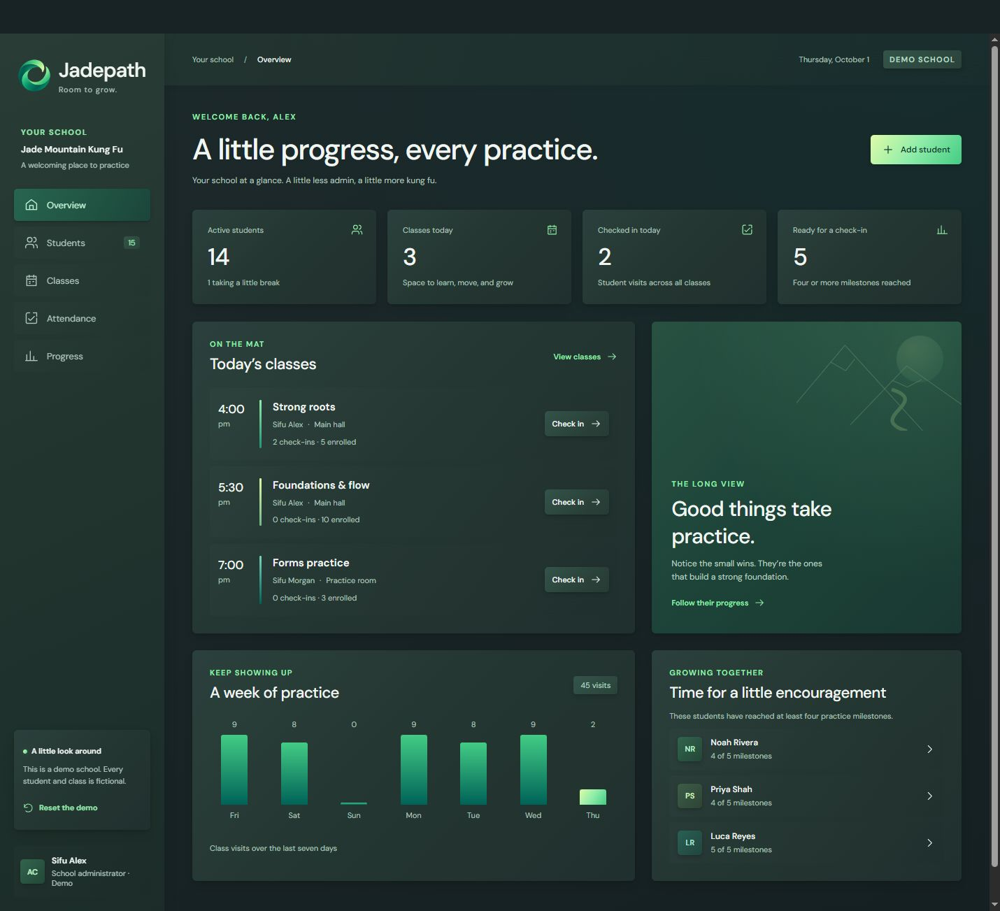

# Jadepath

A little less admin, a little more kung fu.

Jadepath is a demo app prototype for my husband's kung fu school. I'm building it to make the everyday work of running the school a little easier, with a place to keep up with students, welcome them into class, and notice the progress that happens one practice at a time.

Jadepath is a working name, so it might change. For now, it feels like a good place to start.



## Take a look around

The students, school name, and classes in this demo are all made up, so you can take a look around and try things out. You can:

- Find a student and open their profile
- Add a new student to the roster
- Check students into class, or undo a check-in
- Look back at attendance on another day
- Update practice milestones and leave a little note
- Change a student's classes, practice stage, or active status

Changes stay in your browser. If you want a fresh start, use **Reset the demo**.

## A little room to breathe

I wanted the app to feel calm and welcoming. The open jade ring brings together rich greens, teal, and a little pale lime. Those colors carry through the app, with gentle shadows to give everything room to breathe. The profile windows have a touch of frosted glass, with the details kept easy to read.

I'm starting with this dark theme, called Midnight Jade. A light mode will come later.

The sample milestones are just a starting point. Every school teaches a little differently, and I'd like the app to grow around that.

## Where it's headed

I'd love for this to become something we use at the school every day. For now, it's an early prototype and a chance for me to learn Svelte while making something useful. It's built with SvelteKit and TypeScript, and there are no real student records or accounts.

Next, I'll be working through how the school actually runs, from welcoming a new student to checking everyone into class. School accounts, shared records, and a more flexible schedule will come later.

## Run it locally

Use Node.js 24 and npm.

```sh
npm ci
npm run dev -- --host 127.0.0.1 --port 5174
```

Open [Jadepath locally](http://127.0.0.1:5174/).

To run the checks:

```sh
npm run validate
```

That checks the Svelte files, runs the tests, and builds the app. `npm run format` keeps the source tidy.
